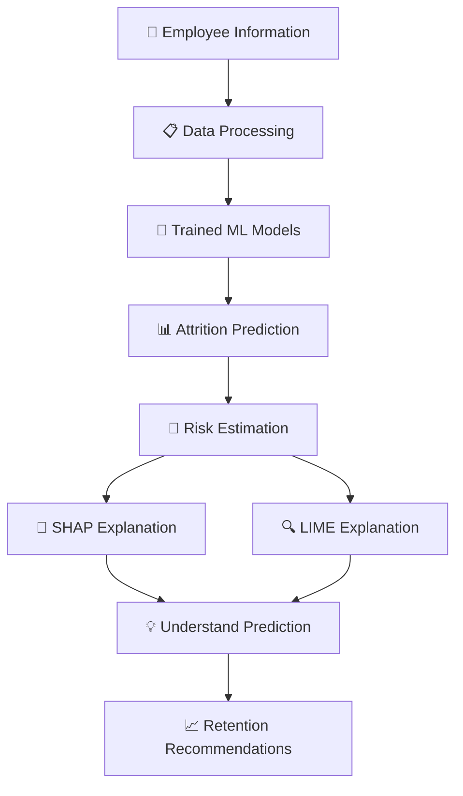

# 👥 AttritionAI

### ✨ Explainable Employee Attrition Prediction using SHAP, LIME & Tree-Based Models


## 🔍 Predict. Explain. Retain.

Making employee attrition predictions more transparent, interpretable and understandable through Machine Learning and Explainable AI.

---

## 🌟 About AttritionAI

AttritionAI is an Explainable Artificial Intelligence (XAI) powered employee attrition prediction application designed to estimate whether an employee is likely to leave an organization and explain the factors influencing the prediction.

Employee attrition can lead to increased recruitment costs, reduced productivity and loss of experienced employees.

AttritionAI combines Machine Learning algorithms with Explainable AI techniques such as SHAP and LIME to make predictions easier to understand.

The application provides an interactive dashboard where users can explore employee data, compare models, understand individual predictions and view possible employee retention recommendations.

💡 **Our goal is not just to predict employee attrition, but to understand why the prediction was made.**

---

## 🎯 The Problem We Solve

Organizations often struggle to identify employees who may leave their jobs.

Traditional prediction systems may provide results without clearly explaining:

- Which employee factors influence attrition.
- Why an employee is classified as having a higher attrition risk.
- Which features contribute most to a prediction.
- How different employee factors affect the model's output.

**Our solution:** An explainable employee attrition prediction system that combines Machine Learning predictions with transparent feature-level explanations.

---

## 🚀 Key Features

| Feature | Description |
|---|---|
| 👥 Employee Attrition Prediction | Predicts employee attrition using trained ML models |
| 🌳 Decision Tree | Classification using a Decision Tree model |
| 🌲 Random Forest | Classification using a Random Forest model |
| 📊 Model Comparison | Compares accuracy, precision, recall and F1-score |
| 🧠 SHAP Explainability | Explains feature contributions to predictions |
| 🔍 LIME Explanations | Provides explanations for individual predictions |
| 📈 EDA Insights | Visualizes employee data and attrition patterns |
| 💡 Retention Recommendations | Provides rule-based employee retention suggestions |
| 🔄 What-if Simulator | Explores how changes in employee factors affect predicted risk |
| 📋 Exit Impact Analysis | Displays potential employee exit impact indicators |
| 📄 PDF Prediction Report | Generates downloadable prediction reports |
| 🕘 Prediction History | Displays previous prediction results |

---

## 🧠 Explainable AI – The Heart of AttritionAI

### 1. SHAP – SHapley Additive exPlanations

SHAP explains how different employee features contribute to a Machine Learning prediction.

**What it provides:**
- Individual employee prediction explanations.
- Positive and negative feature contributions.
- Feature importance visualization.
- Better understanding of model behaviour.

### 2. LIME – Local Interpretable Model-Agnostic Explanations

LIME explains individual predictions by approximating the model locally using an interpretable explanation.

**What it provides:**
- Local prediction explanations.
- Identification of influential employee features.
- Positive and negative feature weights.
- Easier interpretation of complex model predictions.

### 3. Tree-Based Machine Learning

AttritionAI uses two classification algorithms:

- Decision Tree Classifier
- Random Forest Classifier

Both models are evaluated and compared using standard classification metrics.

---

## ⚙️ How AttritionAI Works



---

## 🛠️ Technology Stack

| Category | Technologies |
|---|---|
| Programming Language | Python |
| Frontend / Interface | Streamlit |
| Data Processing | Pandas, NumPy |
| Machine Learning | Scikit-learn |
| Classification Models | Decision Tree, Random Forest |
| Explainable AI | SHAP, LIME |
| Data Visualization | Matplotlib, Seaborn |
| Model Storage | Joblib |
| PDF Generation | ReportLab |

---

## 📊 Model Comparison

The project evaluates two Machine Learning models using the same test dataset.

| Metric | Decision Tree | Random Forest |
|---|---:|---:|
| Accuracy | 77.21% | 83.33% |
| Attrition Precision | 35.71% | 46.88% |
| Attrition Recall | 53.19% | 31.91% |
| Attrition F1-score | 42.74% | 37.97% |

### Key Findings

- Random Forest achieves higher accuracy and precision.
- Decision Tree achieves higher attrition recall and F1-score.
- Decision Tree identifies a larger proportion of actual attrition cases in the test dataset.

**Note:** These are the current evaluation results from the project's saved models and test dataset. They are not guaranteed performance levels on new employee data.

---

## 📂 Project Structure

```text
employee-attrition-xai/
│
├── dashboard/
│   └── app.py
│
├── data/
│   └── cleaned_employee_attrition.csv
│
├── models/
│   ├── decision_tree_model.pkl
│   ├── random_forest_model.pkl
│   └── feature_names.pkl
│
├── README.md
└── requirements.txt
```

*Note: This is the main project structure. Additional files and folders exists in the repository.*

---

## 💻 Installation & Setup

### Prerequisites

- Python 3.10 or later
- Visual Studio Code
- Git

### 1. Clone the Repository

```bash
git clone https://github.com/sahana-cloud28/employee-attrition-xai.git
```

### 2. Navigate to the Project Folder

```bash
cd employee-attrition-xai
```

### 3. Create a Virtual Environment

```bash
python -m venv venv
```

### 4. Activate the Environment

**Windows PowerShell:**

```powershell
venv\Scripts\Activate.ps1
```

### 5. Install Required Libraries

If `requirements.txt` is included:

```bash
pip install -r requirements.txt
```

Alternatively, install the main dependencies:

```bash
pip install streamlit pandas numpy scikit-learn matplotlib seaborn shap lime joblib reportlab
```

### 6. Run AttritionAI

```bash
streamlit run dashboard/app.py
```

🎉 The application will open in your default browser.

**Important:** Ensure the cleaned dataset and trained model files are present in their expected folders before running the application.

---

## 🔄 Project Workflow

1. Load employee dataset.
2. Preprocess employee information.
3. Prepare training and testing data.
4. Train and evaluate classification models.
5. Generate employee attrition predictions.
6. Explain predictions using SHAP.
7. Generate local explanations using LIME.
8. Display analytical insights through the Streamlit dashboard.
9. Provide possible employee retention recommendations.
10. Generate downloadable PDF prediction reports.

---

## 🔮 Future Enhancements

- 🚀 Improve model performance through hyperparameter tuning.
- 📊 Add more advanced model evaluation visualizations.
- ☁️ Deploy the application to a cloud platform.
- 📈 Explore additional Machine Learning algorithms.
- 🔐 Improve data privacy and access controls.
- 📋 Expand employee analytics and retention insights.

---

## ⚠️ Disclaimer

AttritionAI is developed for academic and educational purposes.

The predictions are estimates based on historical employee data. They should not be treated as proof that an employee will leave an organization or used as the sole basis for employment decisions.

The application is intended to support HR analysis and decision-making, not replace human judgment.

---

## 👩‍💻 Project Information

**Project Name:** AttritionAI – Employee Attrition Prediction using Explainable AI

**Domain:** Artificial Intelligence & Machine Learning

**Focus Areas:** Machine Learning, Explainable AI, Data Analytics and Streamlit Development

---

# 💙 ATTRITIONAI

### Predict. Explain. Retain.

*Making Employee Attrition Prediction More Understandable Through Explainable AI.
